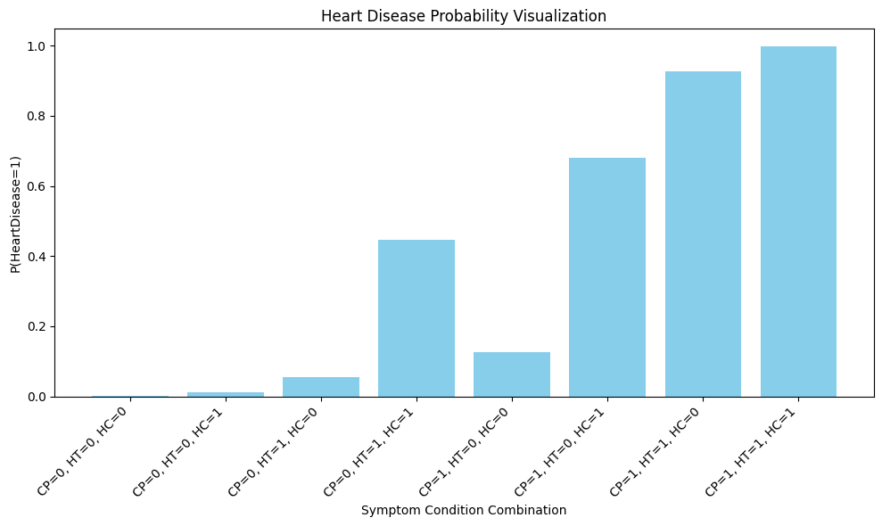

# 베이즈 정리를 이용한 심장병 확률 추론

흉통(Chest Pain), 고혈압(Hypertension), 고콜레스테롤혈증(Hypercholesterolemia) 여부가 주어졌을 때
심장병일 확률 **P(HeartDisease | 증상)** 을 베이즈 정리로 계산하는 간단한 베이지안 네트워크입니다.

- 언어/라이브러리: Python, Matplotlib
- Claude AI는 github 정리에만 사용, 코드 작성에는 미사용함.

```
src/
  bayesian_heart_disease.py   # 노드 정의, 베이즈 추론, 시각화
results/
  heart_disease_probability.png
```

## 방법

1. `Node` 클래스로 증상 노드 3개와 심장병 노드를 만들고, 심장병 노드에 2³ = 8가지 조합의 조건부 확률표(CPT)를 넣습니다.
2. 사전확률 P(HD) = 0.3, 각 증상의 우도 P(증상 | HD)를 곱해 증거 확률을 구합니다.
3. 베이즈 정리 `P(HD | E) = P(E | HD)·P(HD) / P(E)` 로 사후확률을 계산합니다.
4. 사용자가 입력한 증상 조합의 확률을 출력하고, 8가지 조합 전체를 막대그래프로 그립니다.

## 결과



증상이 많아질수록 심장병 사후확률이 커지며, 세 증상이 모두 있을 때(CP=1, HT=1, HC=1) 확률이 가장 높게 나옵니다.

## 참고

- 확률 값들은 참고 논문을 바탕으로 한 **예시 값**이며, 실제 의료 데이터로 학습한 모델이 아닙니다.

## 실행 방법

```bash
pip install -r requirements.txt
python src/bayesian_heart_disease.py
```

실행하면 증상 여부(0/1)를 차례로 입력받습니다.
